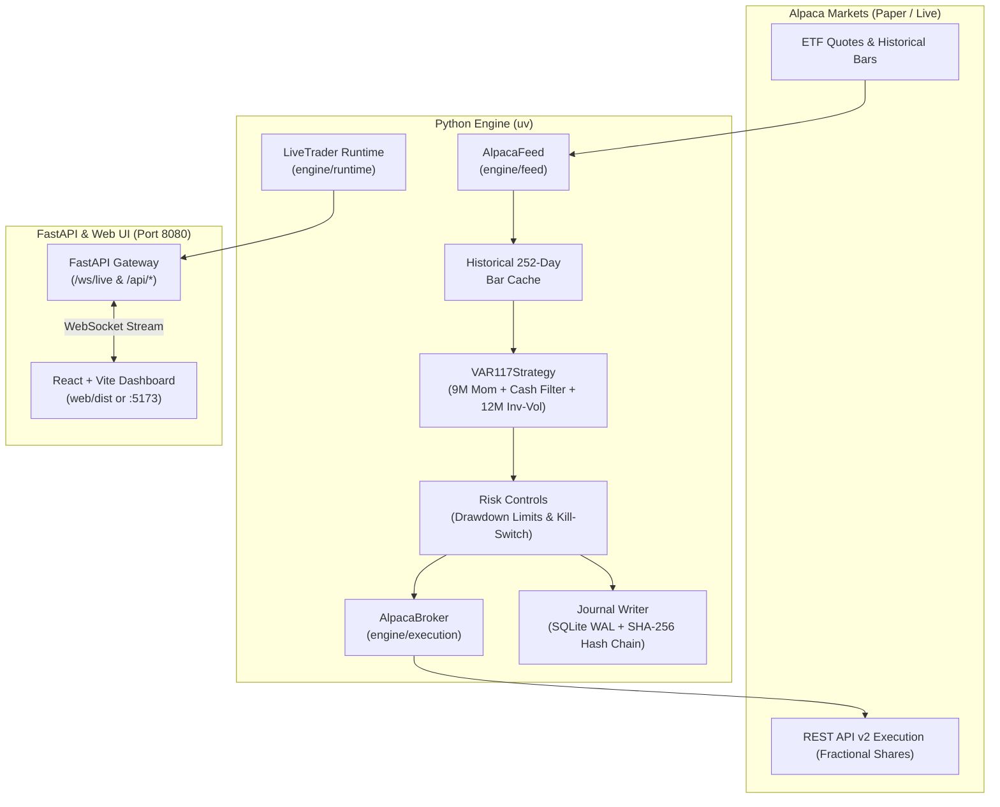
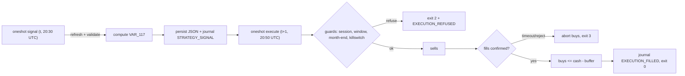

# Gbot — Multi-Asset ETF Momentum Rotation Engine (VAR_117)

Automated **Multi-Asset ETF Momentum Rotation Engine (VAR_117)** trading live/paper via **Alpaca Markets**, engineered with mathematical **Decimal safety invariants**, a thread-isolated **SHA-256 hash-chained SQLite WAL journal**, and a real-time **React + Vite** dashboard styled per Supabase dark aesthetics.

---

## Overview

* **Engine (`engine/`)**: Implements systematic candidate model **VAR_117** (selected from a 294-variant grid search). Ingests daily historical ETF bars and live quotes, ranks assets by 9-month momentum, enforces an absolute momentum Cash Filter, sizes allocations by 12-month inverse-volatility across the top-3 selection, and executes delta rebalancing orders via Alpaca Markets (with automatic in-memory mock paper broker fallback).
* **Risk & Safety (`engine/src/engine/risk/`)**: Enforces strict mathematical invariants—zero floating-point arithmetic across all financial calculations, portfolio-level sizing, a latching drawdown kill-switch, and a thread-isolated SQLite WAL journal.
* **API Gateway (`api/`)**: FastAPI gateway on `127.0.0.1:8080` managing the live trader lifecycle, streaming sub-50ms portfolio allocations, ticker radar rankings, and rebalance timelines over `/ws/live`, and serving REST snapshots.
* **Dashboard (`web/`)**: High-performance React + Vite + Tailwind interface styled with Supabase-inspired dark aesthetics, featuring a live 12-ETF momentum radar, active portfolio holdings, NAV breakdown, and execution logs.

---

## Architecture



---

## Strategy Specification: `VAR_117`

The engine runs candidate model `VAR_117`:

1. **Multi-Asset Universe (12 Liquid US ETFs)**:
   * **Equities:** `SPY` (S&P 500), `QQQ` (Nasdaq 100), `IWM` (Russell 2000), `EFA` (Developed Int'l), `EEM` (Emerging Markets).
   * **Fixed Income:** `IEF` (7-10Y Treasury), `TLT` (20+Y Treasury), `SHY` (1-3Y Treasury), `LQD` (Inv Grade Corporate Bonds).
   * **Real Assets:** `VNQ` (Real Estate/REITs), `GLD` (Gold), `DBC` (Commodities).
   * **Cash Proxy:** Account Cash Balance / FRED 3-Month T-Bill (`TB3MS`).
2. **Momentum Lookback ($L = 9\text{M}$)**: Trailing 189 trading days return ranking.
3. **Selection ($K = 3$)**: Selects the top 3 highest-ranking assets.
4. **Inverse-Volatility Sizing ($V = 12\text{M}$)**: 252 trading days trailing inverse-volatility weights ($w_i \propto 1/\sigma_i$) computed across the top-3 selected assets, normalized so total invested weight $\le 1.0$.
5. **Cash Filter Hurdle ($R_{9\text{M}} > 0$)**: An asset in the top 3 is only held if its trailing 9-month return is strictly positive. If $R_{9\text{M}} \le 0$, its weight is set to 0.0000 and held in cash. Surviving assets retain their original allocation and do *not* re-expand to absorb the failed asset's share.
   - *Quantization & Residual Absorption*: Each asset weight is quantized to 4 decimal places (`0.0001`) via `ROUND_HALF_EVEN` (`engine/src/engine/strategy/etf_momentum.py:210, 214`). The portfolio cash weight is computed as `max(Decimal("0.0000"), Decimal("1.0000") - sum(invested_weights))` (`etf_momentum.py:230`). When all selected assets pass the cash filter, any 4-decimal rounding residual (e.g., `0.0001` when individual quantized weights sum to `0.9999`, as on 2025-09-30) is absorbed into the cash allocation so total invested + cash weight strictly equals `1.0000`.
6. **Execution Timing**: Rebalance signal evaluated at month-end market close ($t$); delta rebalancing executed at market close of the first trading day of the following month ($t+1$, 1-day implementation delay).
   - *Daylight Saving Time (DST) Transitions*: US clocks fall back on Sun 2026-11-01. Signal day 2026-10-30 is evaluated at market close in Eastern Daylight Time (EDT, UTC-4); execution day 2026-11-02 is executed at market close in Eastern Standard Time (EST, UTC-5). All session boundaries and execution schedules must be resolved using `zoneinfo.ZoneInfo("America/New_York")` with pinned `tzdata` rather than fixed UTC offsets to ensure exact market close alignment across clock changes.

---


## Key Invariants & Safety Controls

1. **Zero Floating-Point Arithmetic**: Currency, prices, lot sizing, returns, volatilities, and PnL use Python's `Decimal` exclusively. Binary `float` is strictly prohibited across domain layers.
2. **Latching Portfolio Drawdown Kill-Switch**: If portfolio drawdown or daily loss threshold is breached, the kill-switch latches shut, blocking new buy allocations until an explicit reset. State is persisted and restored across restarts via `journal.db`.
3. **Thread-Isolated Journaling**: SQLite commits never touch the `asyncio` event loop; they run on a dedicated OS background thread fed by a bounded queue using WAL mode.
4. **SHA-256 Hash Chaining**: Every state event committed to SQLite includes the SHA-256 hash of the previous record, producing an immutable, forward-only audit chain.
5. **Deterministic Timezones**: Timestamps are stored in UTC. Market hours and month-end algorithmic rebalancing windows are evaluated via `zoneinfo.ZoneInfo("America/New_York")` with pinned `tzdata`.

---

## Prerequisites

* **Operating System**: macOS, Linux, or Windows.
* **Python**: `3.12` managed via [uv](https://docs.astral.sh/uv/).
* **Node.js**: `v20+` and `npm` for the frontend dashboard.
* **Alpaca Markets Account** *(Optional)*:
  * For paper or live trading, obtain API keys from [Alpaca Markets](https://alpaca.markets/).
  * If API keys are omitted, the engine automatically falls back to an **in-memory mock paper broker** with $100,000 cash for testing.

---

## Quick Start

### 1. Install Dependencies

Sync Python dependencies via `uv` and install frontend dependencies:

```bash
# 1. Sync Python dependencies via uv
uv sync

# 2. Install web frontend dependencies
cd web
npm install
cd ..
```

---

### 2. Verify Setup

Run the full invariant test suite and linters:

```bash
# Run the test suite (520+ tests)
uv run pytest

# Run Ruff linter on engine and API
uv run ruff check engine api

# Typecheck and build the web frontend
cd web && npm run build && cd ..
```

---

### 3. Running the Engine & Dashboard

#### Option A: Development Mode (Hot-Reloading)

Recommended during active development for instant code reloading:

1. **Start the Engine & API Gateway** (Terminal 1):
   ```bash
   uv run uvicorn api.main:app --host 127.0.0.1 --port 8080 --reload
   ```
2. **Start the Vite Dev Server** (Terminal 2):
   ```bash
   cd web
   npm run dev
   ```
3. **View Dashboard**: Open your browser to [http://localhost:5173](http://localhost:5173).

---

#### Option B: Standalone Production Mode (Single Port 8080)

Builds the frontend production bundle and lets FastAPI serve both API endpoints and dashboard UI on port `8080`:

1. **Build the Web Frontend**:
   ```bash
   cd web
   npm run build
   cd ..
   ```
2. **Launch the Production Server**:
   ```bash
   uv run uvicorn api.main:app --host 127.0.0.1 --port 8080
   ```
3. **View Dashboard**: Open your browser directly to [http://127.0.0.1:8080](http://127.0.0.1:8080).

---

## Configuration

### Broker & Strategy Configuration

Configured in [`config/alpaca.yaml`](config/alpaca.yaml):

```yaml
paper_mode: true
base_url: "https://paper-api.alpaca.markets"
rebalance_frequency: "monthly"
universe:
  - "SPY"
  - "QQQ"
  - "IWM"
  - "EFA"
  - "EEM"
  - "IEF"
  - "TLT"
  - "SHY"
  - "LQD"
  - "VNQ"
  - "GLD"
  - "DBC"
top_k: 3
momentum_lookback_days: 189
volatility_lookback_days: 252
cash_filter: true
max_portfolio_drawdown_pct: "0.10"
```

### Risk Controls

Configured in [`config/risk.yaml`](config/risk.yaml):

```yaml
risk_per_trade: "0.01"        # 1% equity risked per trade
daily_loss_limit_r: "3"       # -3R trips latching kill-switch until 17:00 NY rollover
```

> [!IMPORTANT]
> All numerical values in `risk.yaml` and risk-sensitive configs must be quoted strings so they parse directly as exact `Decimal` objects without floating-point imprecision.

### Environment Variables

Configure API keys in a local `.env` file (automatically ignored by git):

```bash
# Alpaca Markets API Credentials (leave empty for local Mock Broker)
APCA_API_KEY_ID="your_alpaca_key_id"
APCA_API_SECRET_KEY="your_alpaca_secret_key"
APCA_API_BASE_URL="https://paper-api.alpaca.markets"

# Telegram Execution & Alert Notifications (optional)
TELEGRAM_BOT_TOKEN="your_bot_token"
TELEGRAM_CHAT_ID="your_chat_id"
```

---

## Repository Structure

```
Gbot/
├── api/
│   └── main.py              # FastAPI application: lifespan, /ws/live, /api/*
├── config/
│   ├── alpaca.yaml          # Alpaca broker, universe, lookbacks, rebalancing
│   └── risk.yaml            # Exact Decimal risk policy and drawdown limits
├── engine/
│   ├── src/engine/
│   │   ├── domain/          # Immutable events, orders, positions, ledger (Decimal)
│   │   ├── execution/       # alpaca_broker.py: REST API v2 execution & mock broker
│   │   ├── feed/            # alpaca_feed.py: 252-day bar cache & live quote feed
│   │   ├── journal/         # Thread-isolated SQLite WAL writer + SHA-256 hash chain
│   │   ├── market/          # Quote/Bar models, bar builders, instrument specs
│   │   ├── risk/            # Drawdown limits, sizing, kill-switch, Decimal rounding
│   │   ├── runtime/         # live_trader.py: orchestrates feed -> strategy -> broker -> WS
│   │   └── strategy/        # etf_momentum.py: VAR_117 Momentum Rotation & Cash Filter
│   └── tests/               # 520+ tests mirroring src/ + static invariant scans
├── web/                     # React + Vite + Tailwind CSS dashboard (Supabase design)
│   ├── src/
│   │   ├── components/      # ETFRadar, HoldingsTable, PortfolioSummaryCards, RebalanceTimeline
│   │   └── hooks/           # useLiveTrader WebSocket connection & snapshot hook
├── research/                # Quantitative backtesting, pre-registration docs, and reports
├── AGENTS.md                # Authoritative operating guidelines & invariant rules
├── DESIGN-supabase.md       # UI/UX design specification
└── pyproject.toml           # uv project configuration and toolchain
```

---

## Research & Empirical Validation

Candidate `VAR_117` emerged from an exploratory 294-variant grid search evaluated across 18.8 years of historical daily ETF bars (2007-03-01 through 2025-12-31; 226 full monthly periods). All 2026 data was strictly sealed and untouched during the search.

### Pre-Registered Decision Ladder Protocol & Gate Status

Per [`research/prereg/etf_search_v1.md`](research/prereg/etf_search_v1.md) §8:
> - **PASS:** All gates G1 through G7 are satisfied.
> - **HISTORICAL-ONLY:** Gates G1 through G6 pass; Gate G7 (forward paper trading) is pending execution.
> - **FAIL:** Any gate G1 through G6 fails.

**Live Capital Authorization:** Under the pre-registration protocol, a **FAIL** on any gate G1–G6 strictly prohibits live capital allocation. Because Gate G4 failed ($DSR = 0.3057 < 0.9500$), candidate `VAR_117` holds an authoritative verdict of **FAIL**; **zero real capital is permitted**, and all forward signals are strictly **paper-only observation**.

| Gate | Criterion Description | Evaluation Window | Threshold | Candidate `VAR_117` | Verdict |
| :--- | :--- | :--- | :--- | :--- | :---: |
| **Gate G1** | Absolute Return Hurdle (Net CAGR > Cash) | 2007-03-01 to 2025-12-31 (18.8y) | $> 1.45\%$ | **11.15\%** (vs Cash: 1.45\%) | **PASS** |
| **Gate G2** | Risk-Adjusted Edge (Net Sharpe CAGR > Bench A) | 2007-03-01 to 2025-12-31 (18.8y) | $> 0.4760$ | **0.9166** (Bench A: 0.4760) | **PASS** |
| **Gate G3** | Downside Protection (Net MaxDD < Bench A) | 2007-03-01 to 2025-12-31 (18.8y) | $< 32.48\%$ | **16.71\%** (Bench A: 32.48\%) | **PASS** |
| **Gate G4** | Multiple Testing Adjustment (Deflated Sharpe Ratio) | 2007-03-01 to 2025-12-31 (227m) | $\ge 0.9500$ | **0.3057** ($N=294$, z = -0.51) / **0.6433** ($N_{\text{eff}}\approx 14$) | **FAIL** |
| **Gate G5** | Parameter Plateau Stability (Neighbours Pass G1–G3) | 6 adjacent grid cells | $\ge 70.0\%$ | **83.3\%** (5 of 6 neighbours pass) | **PASS** |
| **Gate G6** | Sub-Period Consistency (Both Halves Pass G1–G3) | P1: 2007-03 to 2016-07<br>P2: 2016-08 to 2025-12 | P1 & P2 Pass | **P1: PASS** (0.8563)<br>**P2: PASS** (0.9887) | **PASS** |
| **Gate G7** | Forward Paper-Trading Verification (6 Months) | Forward 6-month paper run | 6 Months Logged | **NOT STARTED** | **NOT STARTED** |

> [!NOTE]
> **Deflated Sharpe Ratio (DSR) Context:** While `VAR_117` passed historical performance gates G1, G2, G3, G5, and G6, it **failed Gate G4** under the standard Bailey & López de Prado (2014) multiple testing penalty across 294 trials. Spectral decomposition revealed high trial cross-correlation ($\bar{\rho} = 0.686$), yielding $N_{\text{eff}} \approx 14$ effective independent trials ($DSR \approx 0.6433$). Walk-Forward Optimization (2012–2025) and Jackknife asset dropout tests confirmed robust empirical alpha ($+6.4\%$ to $+7.1\%$ net annualized alpha across 0–50 bps friction).

### Production Rebalance Calendar & Paper Signal Rules

* **Evaluation Window:** 2007-03-01 to 2025-12-31 (18.8 years).
* **Sealed Holdout:** 2026 YTD market data was sealed during parameter search.
* **Next Signal Date:** **Friday, October 30, 2026** (evaluated at 16:00 ET close).
  - Given the Gate G4 FAIL verdict and the pre-registered decision ladder, this is strictly a **PAPER-ONLY signal** (no live capital).
* **Next Execution Date:** **Monday, November 2, 2026** (executed via DAY market orders at ~15:50–15:55 ET, to match the backtest's next-close fill; fractional orders cannot participate in market close auctions).

### Pre-October 30 Hardening Requirements (P0 Items 2–5)

The following operational hardening items are tracked for completion prior to the October 30, 2026 paper signal (P0 Item 1 is addressed via `engine/src/engine/feed/refresh_data.py`):

| Item | Focus | Status | Details & Verification |
| :--- | :--- | :---: | :--- |
| **P0 #1** | Historical Cache Refresh & Manifest | **IMPLEMENTED** | `refresh_data.py` atomic CSV fetch and SHA-256 `manifest.json`. Rejects in-progress bars against `last_completed_session(now_ny)`. Refuses refreshing directly into seed directory. |
| **P0 #2** | Dated bars end-to-end & As-Of Semantics | **IMPLEMENTED** | Feed returns `(date, adj_close)` tuples. Strategy enforces explicit `as_of_date` matching latest bar, rejects NYSE calendar gaps, and enforces monotonic alignment. Two-phase flow: signal phase after close on $t$, execution phase next session at ~15:50 ET requiring `signal_date == last_completed_session`. |
| **P0 #3** | Fail loud, no silent fallbacks | **IMPLEMENTED** | Replaced silent clamps with fail-closed exceptions (`ValueError` on zero/negative vol, non-positive price, calendar gaps). One-shot executor exits non-zero on priming, broker, journal, or stale data errors. API returns 503 while degraded. |
| **P0 #4** | Quotes & notional sizing | **IMPLEMENTED** | Structured `Quote(price, timestamp, feed, source)` with mandatory feed (no default). Prior-session and stale quotes rejected. Offline quotes flagged `source="cache"` and strictly rejected in paper/live modes. Sizing executed via notional order values against live broker equity. |
| **P0 #5** | Broker execution modes & Idempotency | **IMPLEMENTED** | Explicit `BROKER=mock\|paper\|live` configuration and `mock: bool = False` flag. Deterministic `client_order_id` keyed on `(signal_date, symbol)`. Full idempotency on crash restarts, open order deduplication, and sell confirmation before buy submission with cash buffer. |

---

## Operations & Scheduled Execution

The rotation engine operates in a decoupled two-phase lifecycle to match the systematic backtest implementation delay ($t \to t+1$ close):



### Pure UTC Operations Schedule

| Phase | Target Date & Time (UTC) | Local Time (US/Eastern) | Action |
| :--- | :--- | :--- | :--- |
| **Signal Phase** | **Friday, 2026-10-30 20:30 UTC** | 16:30 ET (after close) | Refreshes daily bars from Alpaca, validates calendar sequence, computes top-3 selection and inverse-vol weights, persists `latest_signal.json`, and records `STRATEGY_SIGNAL` to SQLite WAL journal. Retries permitted until 21:30 UTC. |
| **Execute Phase** | **Monday, 2026-11-02 20:50 UTC** | 15:50 ET (pre-close) | Loads persisted signal, verifies `signal_date == last_completed_session`, checks `[15:50, 15:58)` ET execution window and kill-switch, submits sells, confirms fills via broker polling, and executes buys capped by available cash minus cash buffer. |

### CLI Entrypoints

Run via `uv`:

```bash
# 1. Signal Phase (Month-End Close)
uv run python -m engine.runtime.oneshot signal \
    --signal-file engine/data/etf_cache/latest_signal.json \
    --data-dir engine/data/etf_cache

# 2. Execute Phase (Next Trading Day Pre-Close)
uv run python -m engine.runtime.oneshot execute \
    --signal-file engine/data/etf_cache/latest_signal.json \
    --data-dir engine/data/etf_cache
```

### Exit Codes

The oneshot CLI returns standard, machine-actionable exit codes for process runners and schedulers:

| Exit Code | Classification | Description |
| :---: | :--- | :--- |
| `0` | **Success** | Phase completed successfully (signal persisted or rebalance executed and confirmed). |
| `1` | **Runtime Failure** | Fatal runtime exception, data corruption, or missing required configuration. |
| `2` | **Systematic Refusal** | Guard refusal: non-NYSE trading session, outside `[15:50, 15:58)` ET window, non-month-end date, or latched kill-switch. |
| `3` | **Incomplete Broker Execution** | Order placement failure, fill confirmation timeout, or sell rejection aborting buys. |

---

## Research Documents & Reports

* **[FINAL_REPORT.md](research/FINAL_REPORT.md)**: Intraday ICT falsification on XAUUSD and FX majors across 11+ years of tick data (finding zero edge net of costs).
* **[FINAL_REPORT_ETF_SEARCH.md](research/reports/FINAL_REPORT_ETF_SEARCH.md)**: Complete 294-variant grid search results, decision ladder verdicts, and audited hand-traces.
* **[DSR_INVESTIGATION_REPORT.md](research/reports/DSR_INVESTIGATION_REPORT.md)**: DSR deconstruction, spectral decomposition ($N_{\text{eff}}$), Walk-Forward Out-of-Sample analysis, and cost sensitivity analysis.

---

## Disclaimer

This software is for educational, research, and algorithmic trading demonstration purposes. Systematic ETF investing carries financial risk. Always verify performance in paper trading mode before committing capital.

