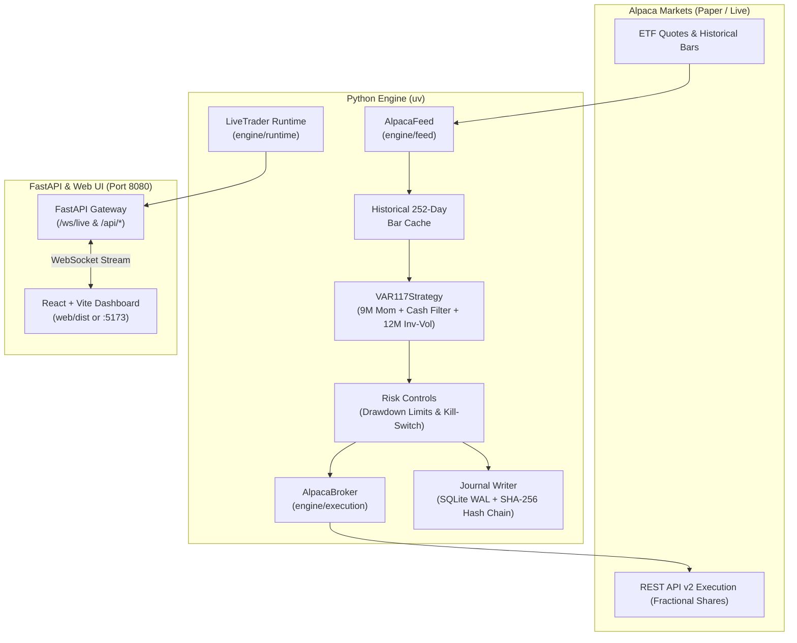

# Gbot — Multi-Asset ETF Momentum Rotation Engine (VAR_117)

Automated **Multi-Asset ETF Momentum Rotation Engine (VAR_117)** trading live/paper via **Alpaca Markets**, engineered with mathematical **Decimal safety invariants**, a thread-isolated **SHA-256 hash-chained SQLite WAL journal**, and a real-time **React + Vite** dashboard styled per Supabase dark aesthetics.

---

## Overview

* **Engine (`engine/`)**: Implements the pre-registered winning systematic model **VAR_117**. Ingests daily historical ETF bars and live quotes, ranks assets by 9-month momentum, enforces an absolute momentum Cash Filter, sizes allocations by 12-month inverse-volatility, and executes delta rebalancing orders via Alpaca Markets (with automatic in-memory mock paper broker fallback).
* **Risk & Safety (`engine/src/engine/risk/`)**: Enforces strict mathematical invariants—zero floating-point arithmetic across all financial calculations, portfolio-level sizing, a latching drawdown kill-switch, and a thread-isolated SQLite WAL journal.
* **API Gateway (`api/`)**: FastAPI gateway on `127.0.0.1:8080` managing the live trader lifecycle, streaming sub-50ms portfolio allocations, ticker radar rankings, and rebalance timelines over `/ws/live`, and serving REST snapshots.
* **Dashboard (`web/`)**: High-performance React + Vite + Tailwind interface styled with Supabase-inspired dark aesthetics, featuring a live 12-ETF momentum radar, active portfolio holdings, NAV breakdown, and execution logs.

---

## Architecture



---

## Strategy Specification: `VAR_117`

The engine runs the pre-registered systematic winner model `VAR_117`:

1. **Multi-Asset Universe (12 Liquid US ETFs)**:
   * **Equities:** `SPY` (S&P 500), `QQQ` (Nasdaq 100), `IWM` (Russell 2000), `EFA` (Developed Int'l), `EEM` (Emerging Markets).
   * **Fixed Income:** `IEF` (7-10Y Treasury), `TLT` (20+Y Treasury), `SHY` (1-3Y Treasury), `LQD` (Inv Grade Corporate Bonds).
   * **Real Assets:** `VNQ` (Real Estate/REITs), `GLD` (Gold), `DBC` (Commodities).
   * **Cash Proxy:** Account Cash Balance / FRED 3-Month T-Bill (`TB3MS`).
2. **Momentum Lookback ($L = 9\text{M}$)**: Trailing 189 trading days return ranking.
3. **Selection ($K = 3$)**: Selects the top 3 highest-ranking assets.
4. **Cash Filter ($R_{9\text{M}} > 0$)**: Absolute momentum hurdle. If an asset in the top 3 has $R_{9\text{M}} \le 0$, its allocation is redirected to cash.
5. **Inverse-Volatility Weighting ($V = 12\text{M}$)**: 252 trading days trailing inverse-volatility weighting among passing assets ($w_i \propto 1/\sigma_i$), normalized so total invested weight never exceeds 100% ($\sum w_i \le 1.0$).
6. **Execution Timing**: Rebalance signal evaluated at month-end market close; rebalancing executed at market open/close of the first trading day of the next month (1-day implementation delay).

---

## Key Invariants & Safety Controls

1. **Zero Floating-Point Arithmetic**: Currency, prices, lot sizing, returns, volatilities, and PnL use Python's `Decimal` exclusively. Binary `float` is strictly prohibited across domain layers.
2. **Latching Portfolio Drawdown Kill-Switch**: If portfolio drawdown or daily loss threshold is breached, the kill-switch latches shut, blocking new buy allocations until an explicit reset. State is persisted and restored across restarts via `journal.db`.
3. **Thread-Isolated Journaling**: SQLite commits never touch the `asyncio` event loop; they run on a dedicated OS background thread fed by a bounded queue using WAL mode.
4. **SHA-256 Hash Chaining**: Every state event committed to SQLite includes the SHA-256 hash of the previous record, producing an immutable, forward-only audit chain.
5. **Deterministic Timezones**: Timestamps are stored in UTC. Market hours and month-end algorithmic rebalancing windows are evaluated via `zoneinfo.ZoneInfo("America/New_York")` with pinned `tzdata`.

---

## Prerequisites

* **Operating System**: macOS, Linux, or Windows.
* **Python**: `3.12` managed via [uv](https://docs.astral.sh/uv/).
* **Node.js**: `v20+` and `npm` for the frontend dashboard.
* **Alpaca Markets Account** *(Optional)*:
  * For paper or live trading, obtain API keys from [Alpaca Markets](https://alpaca.markets/).
  * If API keys are omitted, the engine automatically falls back to an **in-memory mock paper broker** with $100,000 cash for testing.

---

## Quick Start

### 1. Install Dependencies

Sync Python dependencies via `uv` and install frontend dependencies:

```bash
# 1. Sync Python dependencies via uv
uv sync

# 2. Install web frontend dependencies
cd web
npm install
cd ..
```

---

### 2. Verify Setup

Run the full invariant test suite and linters:

```bash
# Run the test suite (520+ tests)
uv run pytest

# Run Ruff linter on engine and API
uv run ruff check engine api

# Typecheck and build the web frontend
cd web && npm run build && cd ..
```

---

### 3. Running the Engine & Dashboard

#### Option A: Development Mode (Hot-Reloading)

Recommended during active development for instant code reloading:

1. **Start the Engine & API Gateway** (Terminal 1):
   ```bash
   uv run uvicorn api.main:app --host 127.0.0.1 --port 8080 --reload
   ```
2. **Start the Vite Dev Server** (Terminal 2):
   ```bash
   cd web
   npm run dev
   ```
3. **View Dashboard**: Open your browser to [http://localhost:5173](http://localhost:5173).

---

#### Option B: Standalone Production Mode (Single Port 8080)

Builds the frontend production bundle and lets FastAPI serve both API endpoints and dashboard UI on port `8080`:

1. **Build the Web Frontend**:
   ```bash
   cd web
   npm run build
   cd ..
   ```
2. **Launch the Production Server**:
   ```bash
   uv run uvicorn api.main:app --host 127.0.0.1 --port 8080
   ```
3. **View Dashboard**: Open your browser directly to [http://127.0.0.1:8080](http://127.0.0.1:8080).

---

## Configuration

### Broker & Strategy Configuration

Configured in [`config/alpaca.yaml`](config/alpaca.yaml):

```yaml
paper_mode: true
base_url: "https://paper-api.alpaca.markets"
rebalance_frequency: "monthly"
universe:
  - "SPY"
  - "QQQ"
  - "IWM"
  - "EFA"
  - "EEM"
  - "IEF"
  - "TLT"
  - "SHY"
  - "LQD"
  - "VNQ"
  - "GLD"
  - "DBC"
top_k: 3
momentum_lookback_days: 189
volatility_lookback_days: 252
cash_filter: true
max_portfolio_drawdown_pct: "0.10"
```

### Risk Controls

Configured in [`config/risk.yaml`](config/risk.yaml):

```yaml
risk_per_trade: "0.01"        # 1% equity risked per trade
daily_loss_limit_r: "3"       # -3R trips latching kill-switch until 17:00 NY rollover
```

> [!IMPORTANT]
> All numerical values in `risk.yaml` and risk-sensitive configs must be quoted strings so they parse directly as exact `Decimal` objects without floating-point imprecision.

### Environment Variables

Configure API keys in a local `.env` file (automatically ignored by git):

```bash
# Alpaca Markets API Credentials (leave empty for local Mock Broker)
APCA_API_KEY_ID="your_alpaca_key_id"
APCA_API_SECRET_KEY="your_alpaca_secret_key"
APCA_API_BASE_URL="https://paper-api.alpaca.markets"

# Telegram Execution & Alert Notifications (optional)
TELEGRAM_BOT_TOKEN="your_bot_token"
TELEGRAM_CHAT_ID="your_chat_id"
```

---

## Repository Structure

```
Gbot/
├── api/
│   └── main.py              # FastAPI application: lifespan, /ws/live, /api/*
├── config/
│   ├── alpaca.yaml          # Alpaca broker, universe, lookbacks, rebalancing
│   └── risk.yaml            # Exact Decimal risk policy and drawdown limits
├── engine/
│   ├── src/engine/
│   │   ├── domain/          # Immutable events, orders, positions, ledger (Decimal)
│   │   ├── execution/       # alpaca_broker.py: REST API v2 execution & mock broker
│   │   ├── feed/            # alpaca_feed.py: 252-day bar cache & live quote feed
│   │   ├── journal/         # Thread-isolated SQLite WAL writer + SHA-256 hash chain
│   │   ├── market/          # Quote/Bar models, bar builders, instrument specs
│   │   ├── risk/            # Drawdown limits, sizing, kill-switch, Decimal rounding
│   │   ├── runtime/         # live_trader.py: orchestrates feed -> strategy -> broker -> WS
│   │   └── strategy/        # etf_momentum.py: VAR_117 Momentum Rotation & Cash Filter
│   └── tests/               # 520+ tests mirroring src/ + static invariant scans
├── web/                     # React + Vite + Tailwind CSS dashboard (Supabase design)
│   ├── src/
│   │   ├── components/      # ETFRadar, HoldingsTable, PortfolioSummaryCards, RebalanceTimeline
│   │   └── hooks/           # useLiveTrader WebSocket connection & snapshot hook
├── research/                # Quantitative backtesting, pre-registration docs, and reports
├── AGENTS.md                # Authoritative operating guidelines & invariant rules
├── DESIGN-supabase.md       # UI/UX design specification
└── pyproject.toml           # uv project configuration and toolchain
```

---

## Research & Empirical Validation

The transition from discretionary retail concepts to `VAR_117` is backed by rigorous empirical research:

* **[FINAL_REPORT.md](research/FINAL_REPORT.md)**: Details the adversarial falsification of intraday ICT concepts on XAUUSD and FX majors across 11+ years of tick data (finding zero edge net of costs).
* **[FINAL_REPORT_ETF_SEARCH.md](research/reports/FINAL_REPORT_ETF_SEARCH.md)**: 294-variant grid search identifying `VAR_117` as the candidate model.
* **[DSR_INVESTIGATION_REPORT.md](research/reports/DSR_INVESTIGATION_REPORT.md)**: Deflated Sharpe Ratio (DSR) deconstruction, permutation tests, Jackknife asset dropout robustness, and cost sensitivity analysis.

---

## Disclaimer

This software is for educational, research, and algorithmic trading demonstration purposes. Systematic ETF investing carries financial risk. Always verify performance in paper trading mode before committing capital.
