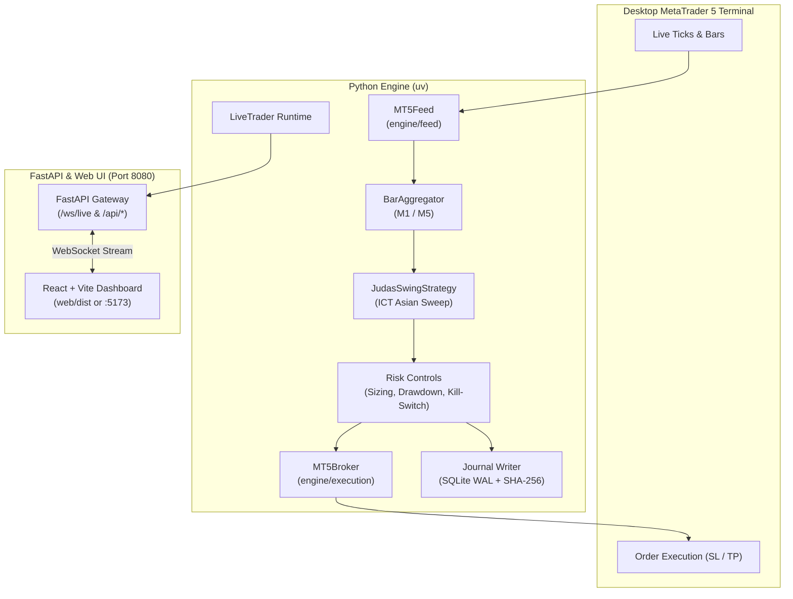

# Gbot — XAUUSD Algorithmic Trading Engine

Automated **XAUUSD (Gold)** trading bot engineered for **MetaTrader 5 (MT5)**, powered by an ICT **Asian Judas Swing** strategy, mathematical Decimal safety invariants, and a real-time React web dashboard.

---

## Overview

* **Engine (`engine/`)**: Connects directly to the MetaTrader 5 desktop terminal, consumes real-time tick quotes, constructs M1/M5 candlesticks, evaluates session liquidity sweeps on closed M5 bars, and executes market orders with mandatory Stop-Loss (SL) and Take-Profit (TP).
* **Risk & Safety (`engine/src/engine/risk/`)**: Enforces strict mathematical invariants—zero floating-point math, dynamic position sizing calculated from account equity and SL distance, a daily loss kill-switch (-3R), and a thread-isolated SHA-256 hash-chained SQLite journal.
* **API Service (`api/`)**: FastAPI gateway running on `127.0.0.1:8080` that manages the live trader lifespan, broadcasts sub-50ms tick and candle streams over `/ws/live`, and serves REST snapshots.
* **Dashboard (`web/`)**: High-performance React + Vite + Tailwind interface styled with Supabase-inspired dark aesthetics, featuring a live TradingView Lightweight Charts canvas and an algorithmic New York session clock.

---

## Architecture



---

## Key Invariants & Safety Controls

1. **Zero Floating-Point Arithmetic**: Currency, prices, lot sizing, and PnL use Python's `Decimal` exclusively. Binary `float` is strictly prohibited across domain layers.
2. **Mandatory Protected Orders**: Every live order must carry both a positive Stop-Loss and Take-Profit with correct geometry before transmission to the broker. Unprotected orders are rejected.
3. **Latching Kill-Switch**: If daily realized losses hit the limit (-3R), the kill-switch latches shut, blocking all entries until the 17:00 New York trading-day rollover. State persists across restarts via `journal.db`.
4. **Isolated Journaling**: SQLite commits never touch the async event loop; they run on a dedicated OS background thread fed by a bounded queue using WAL mode.

---

## Prerequisites

* **Operating System**: Windows (required by the official `MetaTrader5` Python package).
* **MetaTrader 5 Desktop Terminal**:
  * Installed, opened, and logged into your broker (demo or live).
  * **Algo Trading** button enabled in the MT5 top toolbar.
  * Gold symbol added to Market Watch (e.g., `XAUUSD`, `XAUUSDm`).
* **Python**: `3.12` managed via [uv](https://docs.astral.sh/uv/).
* **Node.js**: `v20+` and `npm` for the frontend dashboard.

---

## Quick Start: How to Initiate & View

### 1. Install Dependencies

Clone the repository and install both backend and frontend environments:

```powershell
# 1. Sync Python dependencies via uv
uv sync

# 2. Install web frontend dependencies
cd web
npm install
cd ..
```

---

### 2. Verify Your Setup

Before running live, execute the invariant test suite and linter:

```powershell
# Run the test suite (500+ unit tests)
uv run pytest

# Run Ruff linter
uv run ruff check .
```

---

### 3. Running the Project

You can run the application in two ways:

#### Option A: Development Mode (Recommended for Development)

Enables hot-reloading for both the API and the React frontend.

1. **Start the Trading Engine & API** (Terminal 1):
   ```powershell
   uv run uvicorn api.main:app --host 127.0.0.1 --port 8080 --reload
   ```
2. **Start the Vite Dev Server** (Terminal 2):
   ```powershell
   cd web
   npm run dev
   ```
3. **View Dashboard**: Open your browser to [http://localhost:5173](http://localhost:5173).

---

#### Option B: Standalone Production Mode (Single Port 8080)

Builds the frontend production bundle and lets FastAPI serve it directly on port `8080`.

1. **Build the Web Frontend**:
   ```powershell
   cd web
   npm run build
   cd ..
   ```
2. **Launch the Server**:
   ```powershell
   uv run uvicorn api.main:app --host 127.0.0.1 --port 8080
   ```
3. **View Dashboard**: Open your browser directly to [http://127.0.0.1:8080](http://127.0.0.1:8080).

---

## Repository Structure

```
Gbot/
├── api/
│   └── main.py              # FastAPI application, /ws/live and REST endpoints
├── config/
│   └── risk.yaml            # Exact Decimal risk policy (risk per trade, daily limit)
├── engine/
│   ├── src/engine/
│   │   ├── domain/          # Immutable events, orders, positions, ledger (Decimal)
│   │   ├── execution/       # MT5 broker implementation and order placement
│   │   ├── feed/            # MT5 market feed, bar resolution, quote ingestion
│   │   ├── journal/         # Thread-isolated SQLite WAL writer + SHA-256 chain
│   │   ├── market/          # Candle aggregation, Bar/Quote models, specs
│   │   ├── risk/            # Lot sizing, drawdown, latching kill-switch
│   │   ├── runtime/         # LiveTrader orchestrator (Feed -> Strategy -> Broker -> WS)
│   │   └── strategy/        # Asian Judas Swing strategy implementation
│   └── tests/               # Test suites mirroring src/ + invariant verification
├── web/                     # React + Vite + Tailwind CSS dashboard
├── AGENTS.md                # Technical invariant specifications & guidelines
├── DESIGN-supabase.md       # UI/UX design specifications
└── pyproject.toml           # uv project configuration and toolchain
```

---

## Configuration

Risk parameters are configured in [`config/risk.yaml`](config/risk.yaml):

```yaml
risk_per_trade: "0.01"        # 1% equity risked per trade (1R)
daily_loss_limit_r: "3"       # Tripping -3R latches the kill-switch until 17:00 NY
```

> [!IMPORTANT]
> All numerical values in `risk.yaml` must be quoted strings so they parse as exact `Decimal` numbers without floating-point imprecision.

### Telegram Notifications

Real-time execution alerts can be configured in `.env` (automatically ignored by git):

```bash
TELEGRAM_BOT_TOKEN="your_bot_token"
TELEGRAM_CHAT_ID="your_chat_id"
```

The engine sends instant notifications for:
* **Order Placement**: Ticket, direction, lot size, entry price, SL, and TP.
* **Position Closure**: Audited exit price, broker fees, and net realized PnL.
* **Kill-Switch Alerts**: Immediate warning if the -3R daily loss limit is reached.

---

## Disclaimer

This software is for educational, research, and algorithmic trading demonstration purposes. Trading leveraged financial instruments such as Gold (XAUUSD) carries significant risk. Test thoroughly on a demo account before risking live capital.
